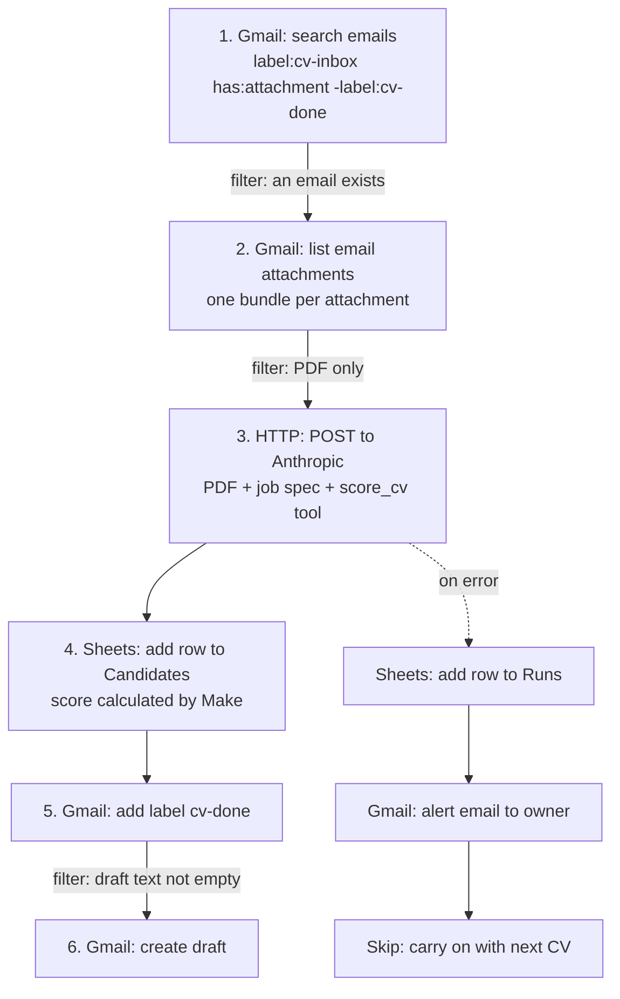
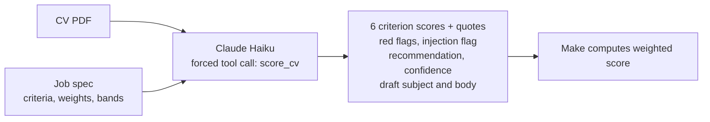

# Workflow diagrams

## The Make scenario, module by module

## What the AI returns for each CV

## Where a human stays in control

| Point | Who decides |
|---|---|
| Which CVs get invited | Recruiter reads the Sheet and the drafts, then sends or edits |
| Declines | Only ever a draft. Nothing is sent unless a person clicks Send |
| Borderline (40 to 69), unreadable, suspicious or low-confidence CVs | Always a person |
| The Decision column in the Sheet | Filled in by the recruiter |

## Failure paths

| What goes wrong | What happens |
|---|---|
| The AI call fails (bad key, timeout, outage) | A row in `Runs`, an alert email, the CV is skipped and stays unlabelled so it is retried on the next run |
| Attachment is not a PDF | Filtered out before the AI call |
| Blank or unreadable PDF | Scored 0, `needs_human`, no draft |
| CV contains hidden instructions | Ignored, flagged, `needs_human`, no draft |
| Sheet write fails after the AI call | Make shows the error and notifies the owner. The email is not labelled, so the next run retries it (possible duplicate row) |
| The same email is run twice | The `cv-done` label excludes it from the search |

Manual fallback: read the CVs in the `cv-inbox` label and score them by hand against `data/job-spec.md`.
